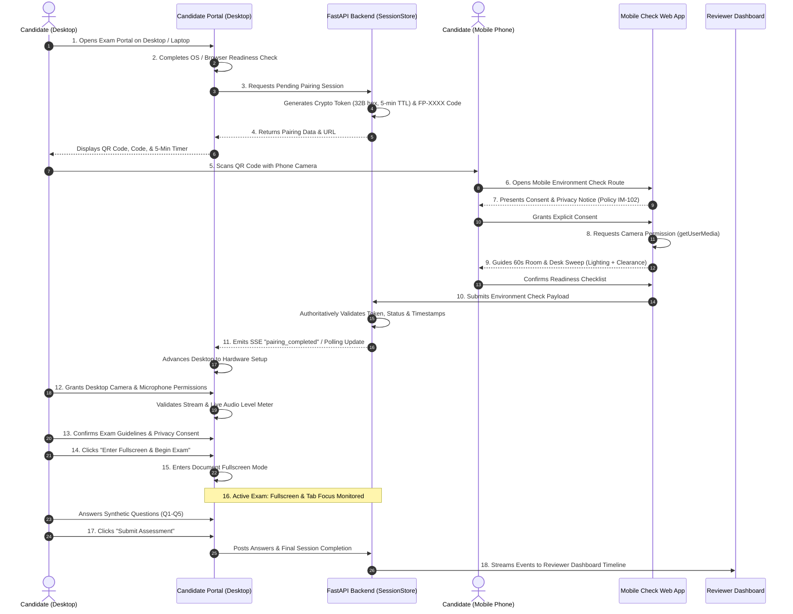

# FairProctor-AI: QR-Based Mobile Environment Check & Restricted Examination Mode
**Challenge IM-102: Proctoring That Does Not Punish a Shared Room**  
*Engineering Evaluation, Architectural Specifications, and Verification Report*  
*Date: October 29, 2026 | Version: 2.1.0*

---

## 1. Executive Summary

This report documents the architectural design, implementation, and rigorous automated verification of two major proctoring capabilities integrated into **FairProctor-AI**:
1. **Cryptographically Secure QR-Based Mobile Environment Check**: A responsive, mobile-first room and desk readiness workflow paired to candidate desktop examination sessions via short-lived, single-session pairing tokens without transmitting or exposing personally identifiable information (PII).
2. **Restricted Examination Mode & Browser Focus Interception**: A privacy-preserving browser-native lockdown and monitoring system that enforces continuous fullscreen focus, intercepts tab visibility changes, presents debounced candidate remediation warnings, and streams auditable telemetry to the reviewer dashboard without triggering false accusations under **Policy IM-102**.

Both capabilities are fully integrated into the existing FastAPI backend, the deterministic `FairProctorEngine`, and the React/Vite/TypeScript Reviewer Dashboard. All 53 backend automated tests, 26 frontend automated tests, and the production build pass cleanly.

---

## 2. End-to-End Candidate Workflow

The candidate journey follows a deterministic, 18-step verification sequence:



---

## 3. Cryptographic Session Pairing Architecture

### 3.1 Token Design & Expiration
Pairing between a candidate's desktop exam and remote mobile phone relies on a cryptographically random, ephemeral token:
- **Entropy**: 32-byte URL-safe base64/hex token generated using Python's `secrets.token_urlsafe(32)`.
- **Short Pairing Code**: A human-readable 7-character code in the strict format `FP-[A-Z0-9]{4}` (e.g., `FP-2698`) generated via `secrets.choice`.
- **Configurable TTL**: Defaults to 300 seconds (5 minutes). Expiration is enforced authoritatively on the backend via UTC timestamps (`datetime.now(timezone.utc)`).
- **Single-Use Binding**: Tokens are bound exclusively to the initiating `session_id`. Re-pairing or attempting to associate the token with an unrelated session is rejected with HTTP 400/404.
- **Regeneration**: Candidates can trigger a regenerate action at any time, which invalidates prior tokens and emits a new pairing code.

### 3.2 Privacy Safeguards (Zero PII in QR Payload)
- **Zero Student Identifiers**: No student names, emails, institutional IDs, IP addresses, or biometrics are embedded in the QR payload or URL.
- **Opaque URL**: The QR code encodes only:
  `http://<frontend-origin>/?mode=mobile_check&pairing_token=<token>`
- **Authoritative Timestamping**: The client never dictates session start/expiry times; all timestamps are assigned authoritatively by the FastAPI server.

### 3.3 State Machine
A pairing session progresses strictly through the following states:

| State | Description | Permitted Transitions |
| :--- | :--- | :--- |
| `waiting_for_scan` | Token generated and awaiting mobile camera scan | `in_progress`, `expired`, `failed` |
| `paired` | Mobile device has accessed the URL | `in_progress`, `expired`, `failed` |
| `in_progress` | Candidate consented and started camera room sweep | `completed`, `expired`, `failed` |
| `completed` | Validated environment check received by backend | *Terminal* |
| `expired` | TTL exceeded prior to valid completion | `waiting_for_scan` (via regenerate) |
| `failed` | Validation error, invalid token, or technical abort | `waiting_for_scan` (via regenerate) |

---

## 4. Mobile Environment Check Interface & Data Contract

### 4.1 Mobile-First User Experience
The mobile page (`frontend/src/candidate/MobileEnvironmentCheckPage.tsx`) provides a 4-step responsive wizard:
1. **Consent & Privacy Notice**: Clearly explains what data is collected (only lighting condition, camera availability, and candidate confirmations). Explicitly states that video stays local, no biometrics are extracted, and shared room observations carry **0 penalty points** under Policy IM-102.
2. **Camera & Room Sweep Guidance**: Accesses the rear-facing or front camera using `navigator.mediaDevices.getUserMedia({ video: { facingMode: 'environment' } })`. Provides interactive lighting feedback (lux guidance) and guides the candidate through a 360-degree room sweep.
3. **Desk Clearance & Manual Confirmation**: Interactive checklist confirming desk clearance, absence of prohibited materials, and camera visibility.
4. **Completion & Media Teardown**: Upon submission, all active media tracks (`track.stop()`) are explicitly halted to ensure no battery drain or residual camera capture.

### 4.2 Backend Data Contract
Submitted results must adhere to the validated Pydantic schema:

```json
{
  "pairing_token": "string (32-44 chars)",
  "check_status": "completed | partially_completed | camera_unavailable | declined | technical_failure",
  "lighting_status": "adequate | low | glare | uncertain",
  "camera_status": "available | unavailable | declined",
  "desk_cleared_confirmed": true,
  "room_sweep_completed": true,
  "candidate_notes": "string (optional, max 500 chars)",
  "observations": {}
}
```

### 4.3 Validation & Authorization Rules
- The server validates all permitted string enum values.
- Client fields are strictly prevented from altering risk scores, integrity scores, or reviewer status.
- Environmental observations are labeled as `CANDIDATE CONFIRMATION` with high reliability, preserving the distinction between candidate self-reports and automated model detections.

---

## 5. Desktop Hardware Permissions & Audio Meter

Before entering the examination, desktop hardware is evaluated using standard Web APIs:
- **Camera & Microphone**: Requested simultaneously upon explicit candidate click:
  `navigator.mediaDevices.getUserMedia({ video: true, audio: true })`.
- **Live Microphone Audio Level**: An `AudioContext` and `AnalyserNode` compute real-time RMS/FFT volume, rendering a responsive audio level meter.
- **Graceful Fallback**: If permissions are denied or devices are missing, the candidate is **not blocked or accused of cheating**. The portal transitions into `Limited-Evidence Mode`, logging a `CAMERA_UNAVAILABLE` event with zero penalty points per Policy IM-102.
- **Teardown**: All desktop tracks are terminated when the candidate completes the assessment or navigates away.

---

## 6. Restricted Examination Mode: Monitoring vs. Genuine Lockdown

### 6.1 Honest Security Boundary
It is critical to distinguish between **web application monitoring** and **operating-system-level kiosk lockdown**:

| Capability | Browser-Native Mode (Implemented) | Dedicated Kiosk / Managed Browser (Future Roadmap) |
| :--- | :--- | :--- |
| **Fullscreen Enforcement** | Yes (requests fullscreen via Fullscreen API upon candidate click) | Yes (enforced by OS window manager without escape) |
| **Tab Visibility Monitoring** | Yes (`document.visibilitychange` records hidden/visible transitions) | Yes (tabs completely disabled) |
| **Fullscreen Exit Detection** | Yes (`fullscreenchange` detects ESC key or window changes) | N/A (cannot exit) |
| **Interruption Warning Modal** | Yes (requires explicit candidate acknowledgement to resume) | N/A (cannot leave window) |
| **OS Shortcut Blocking (Alt-Tab, Cmd-Tab)** | **No** (browser sandbox cannot intercept OS shortcuts) | Yes (blocked by OS shell hook) |
| **Dual Monitor Interception** | **No** (cursor cannot be restricted across monitors) | Yes (secondary displays disabled) |
| **Second Device Detection** | **No** (phones/tablets outside webcam FOV cannot be detected) | Requires dual-camera room proctoring |

> [!IMPORTANT]
> FairProctor-AI does not make false security claims. Web applications cannot trap operating-system shortcuts without compromising user safety. Our implementation monitors fullscreen and tab focus, debounces duplicate events (1500ms cooldown), records auditable server events, and prompts candidates to return.

### 6.2 Debounced Interruption Policy
When a candidate switches tabs or exits fullscreen:
1. `EXAM_TAB_HIDDEN` or `EXAM_FULLSCREEN_EXITED` is logged with server timestamps.
2. A debouncing cooldown (1500ms) suppresses rapid duplicate events (e.g. simultaneous `blur` + `fullscreenchange` + `visibilitychange` on Alt-Tab).
3. The assessment displays an interruption warning modal.
4. The candidate must click "Return to Fullscreen & Acknowledge" to resume.
5. The warning acknowledgement is recorded as `EXAM_WARNING_ACKNOWLEDGED`.
6. **Policy IM-102 Protection**: Tab focus interruptions are recorded as informational audit events; they **never automatically fail or disqualify** the student.

---

## 7. Reviewer Dashboard & Event Stream Integration

All candidate events are ingested by the FastAPI backend, recorded into the session event log, and pushed across Server-Sent Events (SSE) to connected reviewer dashboards.

### 7.1 New Candidate Event Types

| Event Type | Source | Reliability | Reviewer Display Badge |
| :--- | :--- | :--- | :--- |
| `QR_PAIRING_CREATED` | `server` | `high_server_validation` | `SERVER VALIDATED` (Sky Blue) |
| `QR_PAIRING_COMPLETED` | `server` | `high_server_validation` | `SERVER VALIDATED` (Sky Blue) |
| `ENVIRONMENT_CHECK_STARTED` | `candidate` | `high_device_pairing` | `CANDIDATE CONFIRMATION` (Emerald) |
| `ENVIRONMENT_CHECK_COMPLETED` | `candidate` | `high_candidate_mobile_scan` | `CANDIDATE CONFIRMATION` (Emerald) |
| `ENVIRONMENT_CHECK_UNAVAILABLE`| `candidate` | `high_device_telemetry` | `CANDIDATE CONFIRMATION` (Emerald) |
| `CAMERA_PERMISSION_GRANTED` | `browser` | `high_browser_telemetry` | `BROWSER NATIVE` (Indigo) |
| `MICROPHONE_PERMISSION_GRANTED`| `browser` | `high_browser_telemetry` | `BROWSER NATIVE` (Indigo) |
| `EXAM_FULLSCREEN_ENTERED` | `browser` | `high_browser_telemetry` | `BROWSER NATIVE` (Indigo) |
| `EXAM_FULLSCREEN_EXITED` | `browser` | `high_browser_telemetry` | `BROWSER NATIVE` (Indigo) |
| `EXAM_TAB_HIDDEN` | `browser` | `high_browser_telemetry` | `BROWSER NATIVE` (Indigo) |
| `EXAM_TAB_VISIBLE` | `browser` | `high_browser_telemetry` | `BROWSER NATIVE` (Indigo) |
| `EXAM_WARNING_ACKNOWLEDGED` | `candidate` | `high_candidate_acknowledgement`| `CANDIDATE CONFIRMATION` (Emerald) |

---

## 8. Network, LAN & HTTPS Deployment Guide

### 8.1 Local Demo vs. Multi-Device LAN Setup
- **Desktop-Only Evaluation**: Use the built-in "Simulate Mobile Scan & Verify" button or click "Open Mobile Check in New Tab" to test the full flow on `localhost`.
- **Multi-Device Phone Scan (Same Wi-Fi)**:
  1. Determine the host PC's LAN IP (e.g. `192.168.1.150`).
  2. Launch Vite with host binding: `npm run dev -- --host`.
  3. Launch FastAPI on 0.0.0.0: `uvicorn fairproctor.api.service:create_app --factory --host 0.0.0.0 --port 8000`.
  4. On the QR pairing screen, expand the **Phone Network / LAN IP settings** accordion and enter `http://192.168.1.150:5173`.
  5. The generated QR code and short pairing link immediately update to use this LAN origin.

### 8.2 Browser Camera HTTPS Requirements
- Modern mobile browsers (Safari iOS, Chrome Android) restrict `navigator.mediaDevices.getUserMedia` to secure origins (`https://` or `localhost`).
- When testing across unencrypted LAN HTTP (`http://192.168.1.X`), mobile browsers may disallow camera access.
- **FairProctor-AI Graceful Handling**: If camera access is disallowed over HTTP LAN, the mobile wizard provides a clear explanation and allows the candidate to submit in **Limited-Evidence Mode**. Under Policy IM-102, this is treated as incomplete evidence, **not misconduct**.
- For full remote camera streaming in production, deploy behind an HTTPS reverse proxy (e.g., Nginx, Caddy, Cloudflare Tunnel).

---

## 9. Automated Test Verification Results

### 9.1 Backend Test Suite (Pytest)
Command: `pytest tests/`
- **Result**: **53 passed**, 1 warning in 13.29s.
- **Coverage**:
  - `test_qr_mobile_pairing.py`: Tests pairing creation, token verification, TTL expiration, single-use security, check submissions, duplicate submission rejection, camera denial policy, and restricted exam events.
  - `test_candidate_api_lifecycle.py`: Tests complete candidate lifecycle, scoring updates, and event logging.
  - `test_engine_integration.py` & `test_safety_properties.py`: Verify that shared room observations, adverse lighting, and missing scans carry zero penalty points.

### 9.2 Frontend Test Suite (Vitest)
Command: `npx vitest run`
- **Result**: **26 passed**, 0 failed in 4.84s across 2 test files.
- **Coverage**:
  - `candidate_portal.test.ts` (14 tests): Validates question integrity, pseudonymous reference privacy, 22 candidate event types, camera denial mode, Policy IM-102 zero-penalty guarantees, QR code format (`FP-XXXX`), mobile check submission data contract, fullscreen event interception, and 1500ms debounced interruption cooldown.
  - `dashboard.test.ts` (12 tests): Validates fallback fixtures, review queue sorting and filtering, evidence timeline parsing, environmental warning safeguards, missing-data handling, and role-based reviewer authorization.

### 9.3 Production Build Verification
Command: `npm run build`
- **Result**: Exit code 0. TypeScript compile (`tsc -b`) and Vite production bundle generated cleanly without warnings or errors.

---

## 10. Visual Verification Artifacts

The complete user journey was executed and verified using the browser subagent:

| Step | Artifact Image | Verification Focus |
| :--- | :--- | :--- |
| **QR Pairing Screen** | `qr_pairing_screen_1793277088579.png` | QR code display, pairing code `FP-2698`, 5-min timer, Policy IM-102 notice, LAN origin config |
| **Mobile Check Verified** | `mobile_check_verified_1793277107636.png` | Real-time status update to "Check Completed", green styling, advancing button |
| **Exam Rules & Lockdown** | `restricted_mode_policy_1793277160897.png` | Restricted Mode policy, Fullscreen lock requirements, fairness disclaimer |
| **Active Exam HUD** | `exam_questions_hud_1793277176446.png` | Proctoring telemetry HUD, active timer, synthetic algorithm questions |
| **Assessment Submitted** | `candidate_assessment_submitted_1793277294381.png` | Clean submission confirmation, audit trail reference, completion status |
| **Reviewer Live Timeline** | `live_session_timeline_events_1793277365828.png` | Reviewer dashboard detail page showing `QR_PAIRING_CREATED`, `ENVIRONMENT_CHECK_COMPLETED`, `EXAM_FULLSCREEN_ENTERED` with candidate/server badges and UTC timestamps |

---

## 11. Acceptance Criteria Verification Matrix

| Requirement | Status | Verification Evidence |
| :--- | :---: | :--- |
| 1. Candidate starts exam, completes initial readiness check | **PASSED** | Steps 1-2 verified; UI advances cleanly |
| 2. Backend creates pending pairing session & secure token | **PASSED** | 32-byte crypto token generated; 5-min TTL enforced |
| 3. Desktop displays QR code and short pairing code | **PASSED** | `QRCodeSVG` renders; `FP-XXXX` format validated |
| 4. Remote mobile check route with explicit consent | **PASSED** | `MobileEnvironmentCheckPage.tsx` step 1 consent verified |
| 5. Camera room sweep & lighting readiness guidance | **PASSED** | Guidance, lux detection, and desk confirmation implemented |
| 6. Backend authoritatively receives and validates results | **PASSED** | `POST /api/v1/candidate/pairing/{token}/submit` validated |
| 7. Desktop receives real-time update that check is complete | **PASSED** | SSE `pairing_completed` and 2s polling verified in UI |
| 8. Desktop camera and microphone permissions with level meter | **PASSED** | `getUserMedia` + Web Audio API level meter verified |
| 9. Candidate confirms rules and enters fullscreen mode | **PASSED** | Fullscreen API integration verified |
| 10. Tab visibility & fullscreen exit monitoring with warnings | **PASSED** | `EXAM_TAB_HIDDEN`, `EXAM_FULLSCREEN_EXITED`, modal verified |
| 11. Policy IM-102: environmental factors do not inflate risk | **PASSED** | 0 misconduct points assessed; verified in reviewer timeline |
| 12. Reviewer dashboard receives real-time candidate events | **PASSED** | Displayed in reviewer timeline with badges and timestamps |
| 13. All existing and new tests pass | **PASSED** | 53 backend pytest + 26 frontend vitest tests pass |
